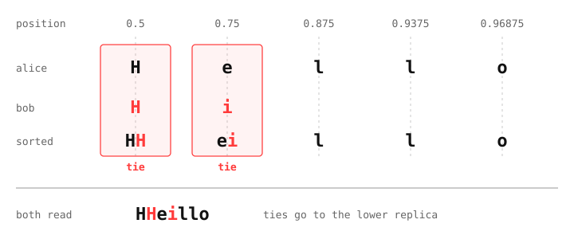
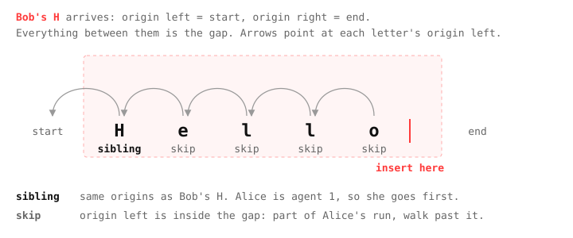

# Replacing Raft with CRDTs, part 3: Text that doesn't interleave

Welcome to part 3 of 4. In [part 1](post.html?post=replacing-raft-with-crdts-1), Alice and Bob ended up with `Hell!o` and `Hello!`. In [part 2](post.html?post=replacing-raft-with-crdts-2) we built a counter and a set that merge in any order. This post finally does the same for text.

The Helo bug happens because of indices. "Insert at 4" means one thing in Bob's document and another in Alice's, because Alice's edit pushed everything after index 3 one place to the right. So give every character a position that never moves.

## Attempt 2: numbers that don't move

This is the idea most people have first. It's also the idea behind Logoot (Weiss, Urso and Molli, 2009), so at least I was in good company. Every character gets a number. A new character gets the number halfway between its neighbours' numbers, and ties are broken by replica ID. Numbers don't shift when you insert, so concurrent inserts commute:

```go
type FracChar struct {
	Pos     float64 // halfway between its neighbours
	Replica uint32  // breaks ties
	Char    rune
}

c := FracChar{(lo + hi) / 2, replica, ch}
```

(Logoot uses lists of digits instead of floats, so it never runs out of precision. Same idea.)

I ran it. It converged. Then I tried the obvious test: Alice types `Hello` into an empty document while Bob, at the same time, types `Hi`. Both replicas agree, perfectly and deterministically, on this:

```
HHeillo
```

Do you see why? Here's the sequence:

1. Both documents start empty, so both `H`s land halfway between 0 and 1: 0.5.
2. Both second letters land halfway between 0.5 and 1: 0.75. Alice's `e`, Bob's `i`.
3. Every pair ties on position, so the replica ID decides, and it decides the same way every time: Alice, Bob, Alice, Bob.
4. The letters zip together until Bob runs out.


*Every tie goes the same way, which is exactly why the replicas agree on the wrong answer.*

That's the **interleaving anomaly**, written up by Kleppmann, Gomes, Mulligan and Beresford in 2019. It's the most annoying kind of bug: every replica agrees, every convergence test passes, and the document is soup.

A number describes *where* a character is. What I actually needed to record was *what it was typed next to*.

## Attempt 3: say next to whom

Every list CRDT since RGA (Roh et al., 2011) works this way. Each character gets a permanent ID, here (agent, sequence number). The agent is just a number naming the replica that typed it. An insert remembers two neighbours. Its **origin left** is the character it was typed after. Its **origin right** is the character that sat to its right at that moment. Positions stop being numbers and become relationships, and relationships don't shift.

There's an immediate cost. You can't actually remove a deleted character, because someone's future insert might name it as a neighbour. So deleted characters stay in the list, flagged, as **tombstones**. Remember this. It sends us an invoice in part 4.

```go
type ID struct{ Agent, Seq uint32 }

// One character, alive or deleted: 32 bytes with padding.
type Item struct {
	ID, OriginLeft, OriginRight ID
	Char                        rune
	Deleted                     bool
}
```

All the cleverness lives in one question. When several people insert into the same gap at the same time, who goes where? The new character belongs somewhere between its two origins. Anything already in that gap was inserted concurrently, and `integrate` walks through it comparing origins:

```go
o := l.Items[i] // something already in the gap
if oleft < left || (oleft == left && oright == right && op.ID.Compare(o.ID) < 0) {
	break // insert here
}
if oleft == left {
	scanning = oright < right // a sibling: hold the decision
}
```

The first time I read a loop like this, it looked like witchcraft. It's really three cases. For each item `o` in the gap:

- **Its origin left is further left than mine.** It was anchored before my anchor, so I stop and insert here.
- **Its origin left is further right than mine.** It was typed inside a run I'm walking past, so I skip it. This is the case that keeps someone's run of typing together.
- **Same origin left.** We're siblings. If our origin rights match too, the lower agent ID goes first. If they don't, `scanning` holds the decision until I know whose run I'm in.

Here's the `HHeillo` test again, with neighbours this time. Alice has typed `Hello`, and Bob's `H` arrives:


*Bob's `H` walks past Alice's whole run, so the result is `HelloHi`, not `HHeillo`.*

Aside: this rule has a family tree. Yjs (the YATA paper, 2016) added the origin right. Joseph Gentle modified it into something he calls YjsMod. Separately, Matthew Weidner and Martin Kleppmann arrived at an almost identical algorithm, **Fugue**, and proved that its variant **FugueMax** is *maximally non-interleaving*. Gentle believes YjsMod is identical to FugueMax. Eg-walker, in part 4, uses this exact rule internally, which means I can test the two against each other.

Back to our two crime scenes:

```go
// Alice inserts "l" at 3, Bob inserts "!" at 4, both on top of "Helo".
// both replicas: "Hello!"

// Alice types "Hello" while Bob types "Hi" into the same empty document.
// both replicas: "HelloHi" (no interleaving; agent 1 sorts first)
```

Here's the original bug and both attempts from this post, running in your browser. Switch the method and try to break it:

<div class="crdt-demo" data-modes="index,frac,fugue" data-mode="fugue" data-preset="empty"></div>

The real tests are meaner than you are: 2,000 random histories (20,000 in the stress run), with up to four replicas typing, deleting and syncing, checking that they always converge.

## Fin

That's part 3. Positions-as-numbers interleave, positions-as-neighbours don't, and the price is that every character, deleted or not, keeps an identity forever.

At this point I had a working collaborative text CRDT. Which is exactly when I made the mistake of measuring it.

[Part 4: Eg-walker →](post.html?post=replacing-raft-with-crdts-4)
