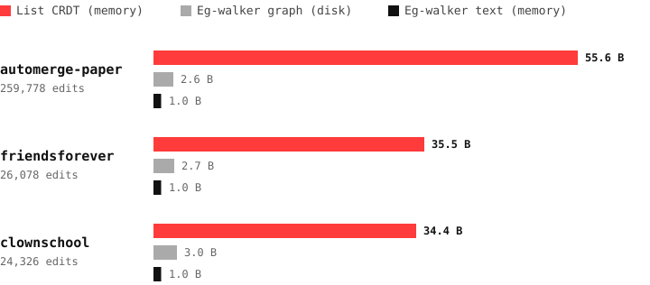
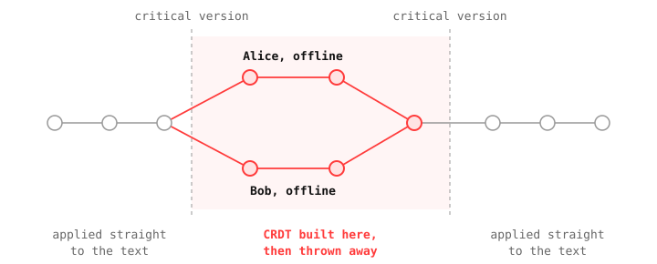

# Replacing Raft with CRDTs, part 4: Eg-walker

Welcome to the last part. [Part 3](post.html?post=replacing-raft-with-crdts-3) ended with a working text CRDT: every character remembers its neighbours, and concurrent typing never interleaves. Then I measured it.

This post is about what that measurement showed, and the algorithm that fixes it: Eg-walker, by Joseph Gentle and Martin Kleppmann (EuroSys 2025, winner of the Best Artifact award).

## Then I measured it

The cost was right there in the struct. I just hadn't looked. Three IDs (24 bytes), a rune (4) and a flag (1), which Go pads to 32 bytes. Per character. For every character anyone has ever typed, including the ones they deleted.

To measure it on real typing, I used the public editing traces Joseph Gentle maintains for exactly this purpose. `automerge-paper` is a keystroke-by-keystroke recording of an academic paper being written: 259,778 edits, ending as a 104,852-character document. Replaying it into my list leaves 182,315 items. That's 5.83 MB to hold about 100 KB of text: **55.6 bytes per visible character**. And 42% of those items are tombstones, characters that no longer exist but are still paying rent.


*Measured with cmd/measure on github.com/josephg/editing-traces · Go 1.24 · all three traces are plain ASCII, so text is 1 byte per character.*

And mine is the lean layout. Automerge's 3.0 announcement says pasting Moby Dick into an Automerge 2 document used 700 MB of memory. Production libraries claw a lot of this back with run-length encoding, storing a run of characters typed in one go as a single entry, but the deeper problem stays: the metadata must be loaded before the document can be shown, it can't be thrown away while some peer might still refer to it, and for almost every keystroke it does absolutely nothing.

It's like carrying an umbrella every single day for the three days a year it actually rains. And the umbrella weighs fifty times more than you do.

Which is exactly the question Eg-walker asks: if concurrency is rare, why keep a CRDT around all the time?

## Only open the umbrella when it rains

Eg-walker stores keystrokes exactly as typed: "insert `l` at index 3", the way operational transformation stores them. A replica keeps only the plain text in memory. When concurrent edits actually need merging, it builds a CRDT, uses it to work out where everything lands, and throws it away. The CRDT state is never written to disk or sent over the network.

### Keystrokes as a graph

An event is a keystroke plus the IDs of the events its author had already seen when they typed it. Every event points back at its parents, so the whole history is a DAG: a directed acyclic graph, where every arrow points back in time. If you've used Git, you already understand this better than you think.

```go
type Event struct {
	ID      ID
	Parents []ID // what its author had already seen
	Pos     int  // an index into *their* document
	Del     bool
	Char    rune
}
```

### Two documents at once

This is the part that took me longest. To replay an event, I need the document as its author saw it, because that's what its index means. But I also need the document with everything merged so far, because that's the text I'm building. Eg-walker keeps both at once, on one list of items:

- each item's `cur` is its state in the **prepare version**, the author's view: not yet inserted, inserted, or deleted;
- its `gone` flag is its state in the **effect version**, the merged text.

Before applying an event, the walker moves the prepare version to that event's parents. That prepare state is stored as a number: −1 not yet inserted, 0 inserted, 1 or more deleted (more than 1 if several concurrent deletes hit the same character). Retreating an insert takes it from 0 to −1, and retreating a delete takes it back down towards 0. Either way it's a single decrement:

```go
retreat, advance := w.g.diff(w.cur, w.g.parents[v])
for _, e := range retreat {
	w.target(e).cur-- // un-delete, or un-insert
}
for _, e := range slices.Backward(advance) {
	w.target(e).cur++
}
w.apply(v, text)
```

Then `apply` does what part 3's list did, with one twist: the index is resolved in the author's view, and the edit is written into the merged text:

```go
i, end := w.seek(e.Pos) // i: the author's view. end: the merged text.
i, end = w.integrate(it, i, end)
w.items = slices.Insert(w.items, i, it)
*text = slices.Insert(*text, end, e.Char)
```

Here's the `Helo` bug from part 1 going through it. The history is six events: four that typed `Helo`, then Alice's "insert `l` at 3" and Bob's "insert `!` at 4", both typed on top of `Helo`.

1. Nothing is concurrent with the first four events, so they go straight into the text: `Helo`.
2. Alice's `l` at 3. Her view is `Helo`, so index 3 means between `l` and `o`. The merged text becomes `Hello`.
3. Bob's `!` at 4. Bob never saw Alice's `l`, so the walker retreats it. In the prepare version it's not inserted yet, Bob's view is `Helo` again, and index 4 means after `o`.
4. In the merged text that `o` sits at index 4, so the `!` goes in at 5: `Hello!`.

Same answer as part 3, except the history only ever stored plain indices. The walker held four items to get there, the `Helo` placeholder split in two plus the two new characters, and then threw them away.

### Knowing when to throw it away

Most of the time, nothing is concurrent. A version is **critical** when every later event descends from it, so nothing after it can be concurrent with anything before it. At a critical version the CRDT is pointless, so the walker drops it on the floor, and keystrokes go straight into the text, exactly like Notepad, which has never had to think about any of this and is thriving:

```go
for v := range g.Events {
	if w == nil && crit[v] {
		text = applyAt(text, g.Events[v]) // nothing concurrent: just edit
		continue
	}
	if w == nil {
		w = newWalker(g, len(text), g.parents[v])
	}
	w.step(v, &text)
	if crit[v] {
		w = nil // throw the CRDT state away
	}
}
```


*An event graph, each event in the order this replica stored it · two critical versions, one concurrent region.*

### The mistake I made

When a walker starts in the middle of a document, the text already contains characters whose history no longer matters. My first version set them up like this:

```go
for i := range n {
	w.items = append(w.items, &item{lv: len(g.Events) + i, n: 1, left: -1, right: -1})
}
```

Do you see it? One item per existing character. On the `friendsforever` trace that put 20,723 items into the walker at its peak. I had built a temporary CRDT bigger than the permanent one it was supposed to replace.

The fix is one placeholder that covers all `n` characters and gets split only where an edit lands:

```go
// All n existing characters become one placeholder item.
w.items = []*item{{lv: len(g.Events), n: n, left: -1, right: -1}}
```

That took the peak from 20,723 items to 502, and the replay from 460 ms to about 25 ms. Splitting is safe because an origin always points at the edge of a piece, and edges, once made, never move.

### What it costs now

| Trace | Events | CRDT built | Events through it | Peak items | Replay |
| --- | --- | --- | --- | --- | --- |
| automerge-paper | 259,778 | 0 times | 0 | 0 | 0.68 s |
| friendsforever | 26,078 | 146 times | 17,046 | 502 | ~25 ms |
| clownschool | 24,326 | 193 times | 17,173 | 499 | ~30 ms |

And the history itself, every keystroke anyone ever typed, encodes to between 2.6 and 3.0 bytes per character of the final document. For `automerge-paper` that's all 259,778 edits in 270 KB. That's what goes on disk, and it's the middle bar for each trace in the chart above. In memory there's just the text, 1 byte per character.

The sequential trace never needs a CRDT at all; its 0.68 s is just copying a flat `[]rune`, which a rope (a tree of text chunks that's cheap to edit in the middle) would mostly remove. On the concurrent traces the walker never holds more than about 500 items, against 23,720 and 22,737 for the list CRDT. (Times are from one core of a cloud VM.)

Is it right, though? Both concurrent traces replay to their recorded final documents, byte for byte. And across 20,000 random histories, with up to four replicas typing, deleting, syncing and receiving duplicates, every replica's Eg-walker text matches part 3's list CRDT exactly.

Note: the authors call Eg-walker a hybrid of CRDTs and OT, so the word "CRDT" in this series' title is doing a little work. Also, my version replays from the beginning of history; Gentle's reference implementation can replay only the events since two branches diverged, which keeps merges cheap after months of history.

## Two laptops walk into a café

Now the plane lands. Syncing comes down to two questions: what do you have, and what am I missing?

Events arrive in causal order and each agent's counter only goes up, so "the highest sequence number I've seen from each agent" describes everything I have. That's a version vector, the same trick that replaced the OR-Set's tombstones in part 2. Given yours, I can send what you lack:

```go
// The events a peer with version vector s doesn't have yet.
for _, e := range r.G.Events {
	if e.ID.Seq > s[e.ID.Agent] {
		out = append(out, e)
	}
}
```

Receiving is where Eg-walker earns its keep. If an incoming event was typed on top of exactly my current version, its index already makes sense in my text, so I apply it directly. Only a genuinely concurrent event triggers a replay:

```go
onTop := slices.Equal(e.Parents, r.G.ids(r.G.Heads))
if fastForward && onTop {
	r.Text = applyAt(r.Text, e) // the common case
} else {
	fastForward = false // something concurrent
}
// ...after the loop:
if !fastForward {
	r.Text, _ = r.G.Checkout()
}
```

Nothing here cares about the transport. A WebSocket relay, WebRTC, or a file on a USB stick all work, and duplicates are harmless because the graph ignores events it already has. A server is allowed back in, just demoted: it relays, stores and backs up. It doesn't get a vote.

## Fin

That's the series. We took Raft out of the typing path, where waiting for a majority was never acceptable. In its place: history stored as plain edits, only the text in memory, and a CRDT built for the few moments when two people really did type at the same time.

All the code is in [crdt-editor](https://github.com/PranavPipariya/crdt-editor) if you want to run it. If you have questions or spot a mistake, find me on [X](https://x.com/0xpermutations) or [GitHub](https://github.com/PranavPipariya).

## Appendix: where Raft comes back

CRDTs promise that replicas converge. They don't promise that the result makes sense, and some promises are impossible without coordination.

- **Invariants.** "The balance never goes below zero." "Usernames are unique." Two offline laptops can each approve withdrawing 80 from a balance of 100. One way out is a *bounded counter* that gives each replica a quota it can spend alone (the Indigo system, EuroSys 2015). The other is consensus, for just that operation. That's the counter from part 2 that must never go below zero.
- **Intent.** Two people fix the same typo differently, and both "win". Concurrent edits to code converge to code that doesn't compile.
- **Permissions.** Who's allowed to edit is itself replicated state. Ink & Switch's Keyhive project is working on local-first access control; it's still open research.
- **Malicious peers.** Ordinary CRDTs assume everyone is honest. Kleppmann's 2022 paper tolerates any number of malicious peers, precisely because CRDTs never need a quorum.

So real systems end up hybrid. Content is CRDT state anyone can change at any time. Decisions that must be unique, like who has access or whether a payment clears, go through one authority or a consensus group. Figma is the famous example of choosing the authority.

## Run it yourself

Everything in this series is one Go module, [crdt-editor](https://github.com/PranavPipariya/crdt-editor): about 830 lines of code and 380 of tests, with etcd's Raft at v3.6.0 as the only direct dependency. `go test ./...` runs the Raft partition test, the trace replays, and 2,000 random histories for each CRDT. `go run ./cmd/measure testdata/*.json.gz` prints the numbers behind the chart and the table. The traces come from Gentle's [editing-traces](https://github.com/josephg/editing-traces) repository.

## Sources

- Gentle and Kleppmann, [Collaborative Text Editing with Eg-walker](https://arxiv.org/pdf/2409.14252), EuroSys 2025, and Kleppmann's [summary post](https://martin.kleppmann.com/2025/04/02/eg-walker-collaborative-text.html).
- Gentle, [eg-walker-reference](https://github.com/josephg/eg-walker-reference), the TypeScript implementation this walker follows.
- Weidner and Kleppmann, [The Art of the Fugue](https://arxiv.org/pdf/2305.00583v1).
- Shapiro, Preguiça, Baquero, Zawirski, [Conflict-free Replicated Data Types](https://dl.acm.org/doi/10.5555/2050613.2050642), SSS 2011, and the shorter [overview](https://arxiv.org/html/1806.10254v1) from 2018.
- [crdt.tech](https://crdt.tech/papers.html), for everything else: OR-Sets, interleaving, RGA, YATA, Logoot.
